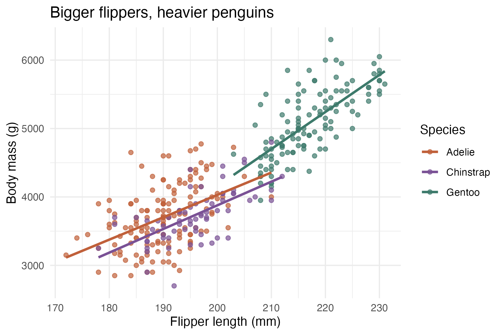

```{r}
#| include: false
source("_helper.R")
library(vellumwidget)
```

If you write ggplot2, you can already read vellumplot. The grammar is the same:
data, marks mapped to columns, scales, labels, a theme. What changes is the
spelling, and the change is mechanical. Here is one plot of the Palmer Penguins
written both ways.

```{r}
pen <- palmerpenguins::penguins
pen <- pen[complete.cases(pen), ]
pal <- c(Adelie = "#c0603a", Chinstrap = "#7a5195", Gentoo = "#3d7a6b")
```

:::: {.columns}

::: {.column width="49%"}
**ggplot2**

```{r gg-code}
#| eval: false
gg <- ggplot(pen, aes(flipper_length_mm,
                      body_mass_g,
                      colour = species)) +
  geom_point(alpha = 0.7) +
  geom_smooth(method = "lm",
              se = FALSE) +
  scale_colour_manual(values = pal) +
  labs(title = "Bigger flippers, heavier penguins",
       x = "Flipper length (mm)",
       y = "Body mass (g)",
       colour = "Species") +
  theme_minimal()

ggsave("penguins.png", gg,
       width = 6, height = 4)
```
:::

::: {.column width="2%"}
:::

::: {.column width="49%"}
**vellumplot**

```{r vp-code}
#| eval: false
vp <- vplot(pen, width = 6, height = 4) |>
  mark_point(x = flipper_length_mm,
             y = body_mass_g,
             colour = species, alpha = 0.7) |>
  mark_smooth(x = flipper_length_mm,
              y = body_mass_g,
              colour = species,
              method = "lm", se = FALSE) |>
  scale_colour_manual(values = pal) |>
  labs(title = "Bigger flippers, heavier penguins",
       x = "Flipper length (mm)",
       y = "Body mass (g)",
       colour = "Species") |>
  theme_minimal()

render_plot(vp, "penguins.png")
```
:::

::::

```{r}
#| include: false
# Run the ggplot2 chunk above exactly as shown. ggplot2 is not attached: its
# labs() and theme_minimal() would mask vellumplot's for the rest of the page.
gg_env <- new.env(parent = environment())
for (nm in getNamespaceExports("ggplot2")) {
  assign(nm, getExportedValue("ggplot2", nm), envir = gg_env)
}
eval(parse(text = sub('"penguins.png"', '"figs/from-ggplot2-gg.png"',
                      knitr::knit_code$get("gg-code"))),
     envir = gg_env)
# And the vellumplot chunk, also as shown, writing its PNG to a temp file.
eval(parse(text = sub('"penguins.png"', 'tempfile(fileext = ".png")',
                      knitr::knit_code$get("vp-code"))))
```

## The five edits

1. **`ggplot(data, aes(...))` becomes `vplot(data)`.** The call takes the data
   and nothing else. There is no plot-wide `aes()`.
2. **`+` becomes `|>`.** Each step is an ordinary function that takes a plot
   and returns a plot, so the native pipe chains them.
3. **`aes()` becomes named arguments on the mark.** `x = flipper_length_mm`
   goes straight into `mark_point()`, and because nothing is inherited, every
   layer names its own columns. A constant, like `alpha = 0.7`, sits next to
   the mappings: a column name maps, a value sets.
4. **`geom_*()` becomes `mark_*()`.** `geom_point()` is `mark_point()`,
   `geom_smooth()` is `mark_smooth()`, and the arguments mean what they meant.
5. **The size moves into the plot.** ggplot2 learns the page size when you save;
   vellumplot is told up front, in `vplot(width = , height = )`, because it lays
   the figure out before drawing it. `render_plot()` then writes the file.

What stays: `scale_colour_manual()`, `labs()` and `theme_minimal()` keep their
names and arguments, and so does the British spelling. `colour` and `color` are
both accepted.

## The two pictures

::: {layout-ncol=2}
{fig-alt="Scatter plot of penguin flipper length against body mass, coloured by species with a straight fit per species, drawn by ggplot2"}

```{r}
#| echo: false
#| fig-cap: "vellumplot"
#| fig-alt: "The same scatter plot drawn by vellumplot: penguin flipper length against body mass, coloured by species with a fitted line per species"
vg(vp, "from-ggplot2-vellum")
```
:::

They are not pixel copies. The two packages pick slightly different point sizes,
line widths and legend keys, and the fonts come from different text engines. But
it is the same plot: same data, same fits, same scales, same theme.

## One more line: a widget

The spec above has never been drawn by a graphics device. It is a description of
the plot, and anything that can read it can host it. Pipe it into `as_widget()`
and the same figure becomes interactive in the browser: hover a point, click a
species in the legend, drag to brush, scroll to zoom.

```{r}
vp |> as_widget()
```

There is no second plotting engine behind that. The widget ships the SVG that
vellum solved plus a table of where every mark landed, so it cannot disagree
with the PNG above.

## Two more lines: an animation

Penguins were measured in three seasons, 2007 to 2009. `transition_states(year)`
turns the plot into one keyframe per season and `animate()` tweens between them.
The scales are trained once over all three years and frozen, so the axes and the
colours never move; only the birds and the fitted lines do.

One argument is new. Each season is a different set of penguins, so the points
get a `data_id`: with it, the tween fades one season's birds out and the next
season's in, instead of sliding a 2007 penguin onto a 2008 one.

```{r}
pen$id <- seq_len(nrow(pen))

a <- vplot(pen, width = 6, height = 4) |>
  mark_point(x = flipper_length_mm, y = body_mass_g,
             colour = species, alpha = 0.7, data_id = id) |>
  mark_smooth(x = flipper_length_mm, y = body_mass_g,
              colour = species, method = "lm", se = FALSE) |>
  scale_colour_manual(values = pal) |>
  labs(title = "Penguins measured in {closest_state}",
       x = "Flipper length (mm)", y = "Body mass (g)",
       colour = "Species") |>
  theme_minimal() |>
  transition_states(year) |>
  animate(nframes = 60, fps = 20)
```

```{r}
#| echo: false
#| fig-alt: "Animation cycling through the 2007, 2008 and 2009 penguin seasons: points fade between seasons while the per-species fitted lines shift slightly"
vg_anim(a, "from-ggplot2-anim")
```

The title is a template: `{closest_state}` is filled in on every frame. For
more, see the [animation pages](index.qmd#category=Animation) and the
[widget pages](index.qmd#category=Interactive).
