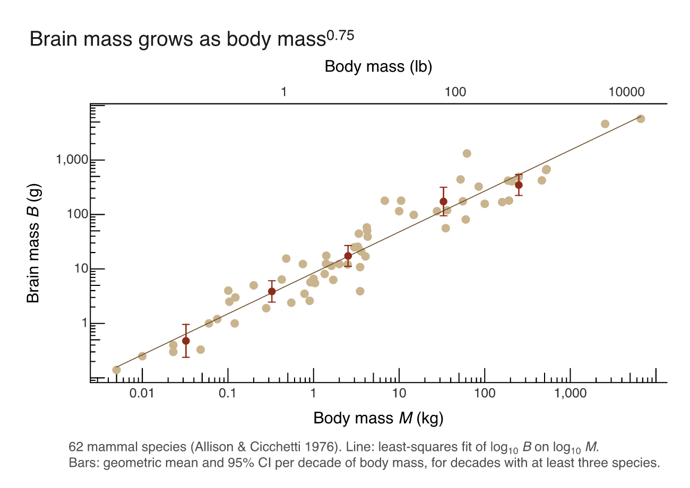
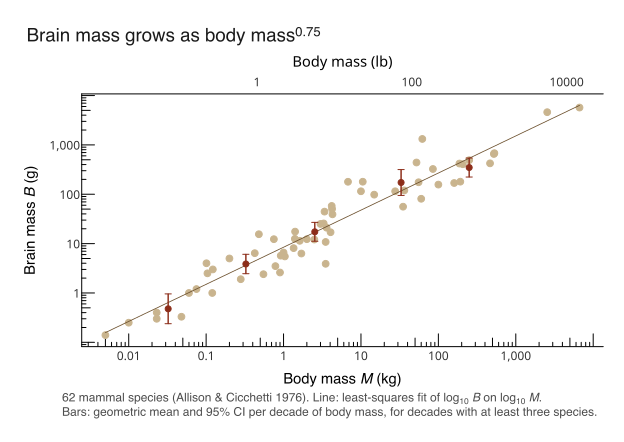

```{r}
#| include: false
source("_helper.R")
```

A figure that goes into a paper has a short list of demands. The axes are often
logarithmic and should look it, with ticks that bunch up toward each power of
ten. Units go in the axis labels, sometimes with italics and exponents. Point
estimates come with intervals. And the same figure has to exist as a PNG for the
slides, an SVG for the web and a PDF for the journal, with nothing moving
between them.

The example is one of the oldest log–log plots in biology: brain mass against
body mass across mammals. On linear axes the elephants squash everyone else into
a corner. On log axes the 62 species of `MASS::mammals` (from Allison and
Cicchetti, 1976) fall on a straight line, and the slope of that line is the
exponent of a power law.

```{r}
m <- MASS::mammals
fit <- lm(log10(brain) ~ log10(body), data = m)
coef(fit)
```

A slope of 0.75 means brain mass grows as body mass to the three-quarters: a
mammal ten times heavier has a brain about 5.6 times heavier.

To show how tight the relationship is, the species are grouped by decade of body
mass (0.01–0.1 kg, 0.1–1 kg, ...). For each decade with at least three species,
the geometric mean brain mass gets a 95% confidence interval, worked out on the
log scale and transformed back.

```{r}
m$decade <- floor(log10(m$body))
bins <- do.call(rbind, lapply(split(m, m$decade), function(d) {
  if (nrow(d) < 3) return(NULL)
  lb <- log10(d$brain)
  half <- qt(0.975, nrow(d) - 1) * sd(lb) / sqrt(nrow(d))
  data.frame(
    body = 10^mean(log10(d$body)),
    brain = 10^mean(lb),
    lo = 10^(mean(lb) - half),
    hi = 10^(mean(lb) + half)
  )
}))

line <- data.frame(body = 10^seq(log10(min(m$body)), log10(max(m$body)), length.out = 50))
line$brain <- 10^predict(fit, line)
```

## What is drawn

Four layers share one pair of log scales: the species as pale points, the fitted
power law as a line, then the decade means. Each mean is drawn twice, as an
`mark_errorbar()` for the capped interval and a `mark_pointrange()` on top for
the estimate and its whisker.

- `scale_*_continuous(trans = "log10")` puts both axes on a log scale, and
  `guide_axis_logticks()` draws the ticks: long ones at each power of ten, medium
  at 5 × 10^k^, short at the other integers in between.
- `sec.axis = sec_axis(~ . * 2.20462)` adds pounds along the top. A secondary
  axis is a relabelling of the primary one, so it takes a formula from kilograms
  to pounds. On a log axis its default breaks are powers of ten as well.
- `md()` labels take a small markdown subset: `*italic*`, `**bold**`,
  `^superscript^` and `~subscript~`. They are measured like any other text, so
  the layout leaves room for the exponent.

```{r}
decades <- 10^(-2:4)
labs10 <- c("0.01", "0.1", "1", "10", "100", "1,000", "10,000")

p <- vplot(m, width = 6.5, height = 4.6) |>
  mark_point(x = body, y = brain, color = "#c9b48e", size = 0.9) |>
  mark_line(data = line, x = body, y = brain, color = "#6b4f2c", linewidth = 0.8) |>
  mark_errorbar(data = bins, x = body, ymin = lo, ymax = hi,
                color = "#8c2d19", width = 0.08) |>
  mark_pointrange(data = bins, x = body, y = brain, ymin = lo, ymax = hi,
                  color = "#8c2d19", size = 0.8) |>
  scale_x_continuous(
    trans = "log10", breaks = decades, labels = labs10,
    guide = guide_axis_logticks(),
    sec.axis = sec_axis(~ . * 2.20462, name = "Body mass (lb)")
  ) |>
  scale_y_continuous(
    trans = "log10", breaks = decades[-1], labels = labs10[-1],
    guide = guide_axis_logticks()
  ) |>
  labs(
    title = md("Brain mass grows as body mass^0.75^"),
    x = md("Body mass *M* (kg)"),
    y = md("Brain mass *B* (g)"),
    caption = md("62 mammal species (Allison & Cicchetti 1976). Line: least-squares fit of log~10~ *B* on log~10~ *M*.\nBars: geometric mean and 95% CI per decade of body mass, for decades with at least three species.")
  ) |>
  theme_classic()
```

## One scene, three files

`render_plot()` picks the format from the file extension. Every one of the three
calls compiles the same spec into the same vellum scene: the text is measured
and the layout solved once, and each backend draws that one answer. So the PNG
is not a screenshot of the SVG and the PDF is not a re-layout. They agree on
where every tick, label and error bar sits.

```{r}
#| eval: false
render_plot(p, "brains.png", dpi = 300)  # raster, for slides
render_plot(p, "brains.svg")             # vector, for the web
render_plot(p, "brains.pdf")             # vector, for the journal
```

```{r}
#| include: false
render_plot(p, "figs/publication-figure.png", dpi = 200)
render_plot(p, "figs/publication-figure.svg")
render_plot(p, "figs/publication-figure.pdf")
```

::: {layout-ncol=2}
{fig-alt="Log-log scatter of brain mass against body mass for 62 mammals with a fitted line of slope 0.75, decade means with error bars, and a secondary axis in pounds along the top"}

{fig-alt="The same figure rendered as SVG"}
:::

Open them side by side and the only difference is the one you would expect:
zoom into the SVG and the PDF and the lines stay sharp. The PDF embeds its fonts,
so it prints the same on a machine that has never seen them.

[Download PNG](figs/publication-figure.png){.btn .btn-primary .btn-sm download="brains.png"}
[Download SVG](figs/publication-figure.svg){.btn .btn-primary .btn-sm download="brains.svg"}
[Download PDF](figs/publication-figure.pdf){.btn .btn-primary .btn-sm download="brains.pdf"}

## Reading it

The decade means sit on the fitted line from shrews to horses, and the
intervals are tight where there are many species (20 in the 1–10 kg decade) and
wide where there are few (6 below 0.1 kg). The two points far above the line in
the middle are the primates: humans (62 kg, 1.3 kg of brain) and the rhesus
monkey sit well above what their body mass predicts. The two at the top right
are the elephants.

For the lower-level version of the three-format story, with vellum grobs and no
grammar on top, see [one scene, three formats](three-formats.qmd).
