::::{.vellum-hero}
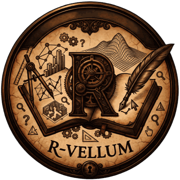{.logo fig-alt="R-vellum emblem: a compass, gears, plots, and a quill on parchment"}

# vellum gallery

::::{.tagline}
The parchment, the pen, and the annotation revealed on the page.
::::

A showcase of what you can draw with the **vellum** graphics ecosystem in R. Its
engine measures text and solves layout before anything reaches a canvas, so a figure
is something you can interrogate, lint, hash, and hand to a browser rather than a
sheet of pixels. The grammar sits on top; the widget reads the same solved scene.

[Browse the gallery](gallery/index.qmd){.btn .btn-primary .btn-lg}
::::

## Why vellum

::::::{.why-vellum}
Six pages that make the case: the grammar you know, data at any size, interaction and animation from the same spec, and figures you can publish.

:::::{.why-grid}

:::{.why-card}
[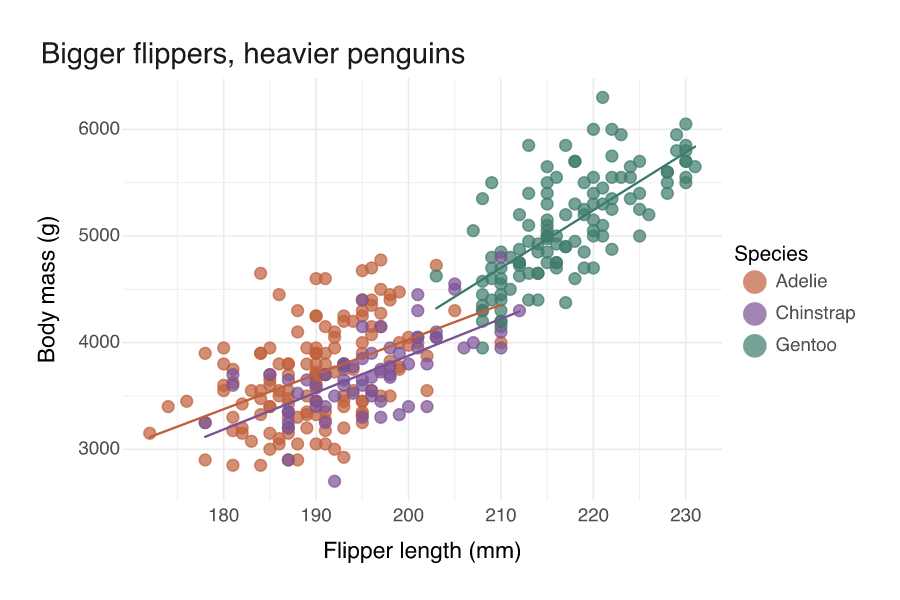{fig-alt="Penguin scatter plot drawn by vellumplot"}](gallery/from-ggplot2.qmd)

### [From ggplot2, in five edits](gallery/from-ggplot2.qmd)

::: {.why-line}
If you write ggplot2 you can read vellumplot. Five mechanical edits, then one line for a widget and two for an animation.
:::
:::

:::{.why-card}
[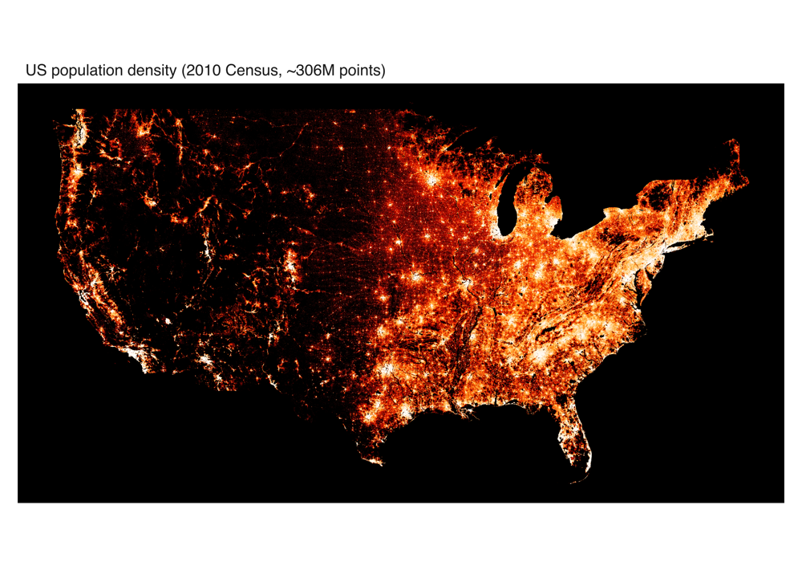{fig-alt="Datashaded map of the US population"}](gallery/datashade-census.qmd)

### [306 million points](gallery/datashade-census.qmd)

::: {.why-line}
Every person in the US Census as a point, datashaded. Big data is binned to the render grid, so nothing is dropped.
:::
:::

:::{.why-card}
[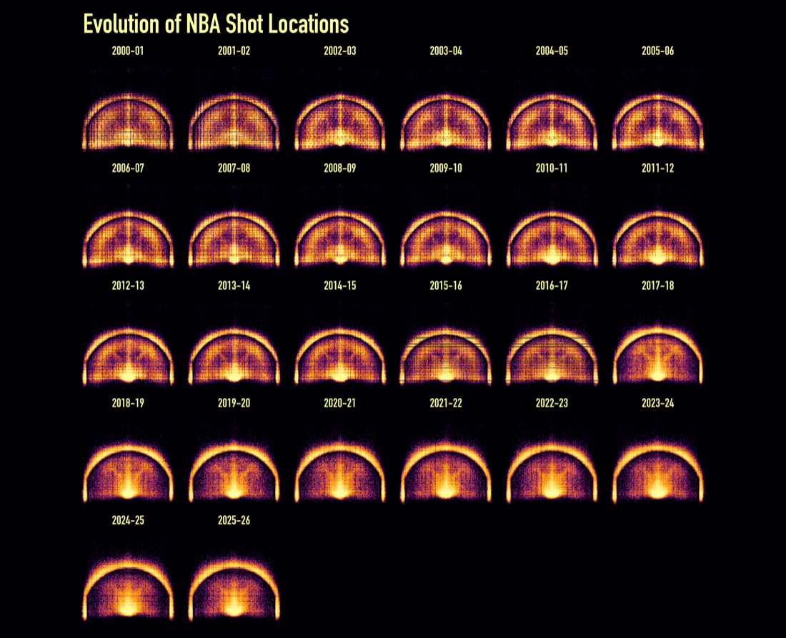{fig-alt="Datashaded basketball half-court of shot locations"}](gallery/nba-shots.qmd)

### [26 seasons of NBA shots](gallery/nba-shots.qmd)

::: {.why-line}
5.2 million shots, one panel per season: the mid-range empties and the three-point arc lights up.
:::
:::

:::{.why-card}
[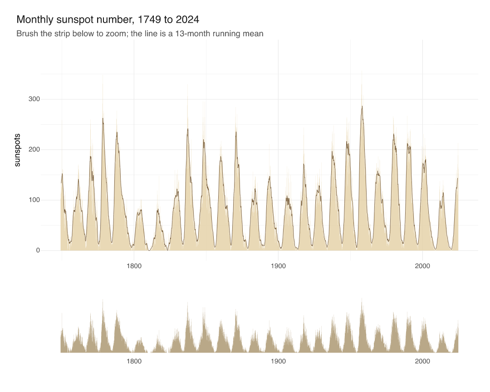{fig-alt="Sunspot time series with an overview strip"}](gallery/overview-detail.qmd)

### [Interaction is part of the spec](gallery/overview-detail.qmd)

::: {.why-line}
Brush an overview, zoom the detail. Declared with select_interval() and bind_scale(); it needs no server.
:::
:::

:::{.why-card}
[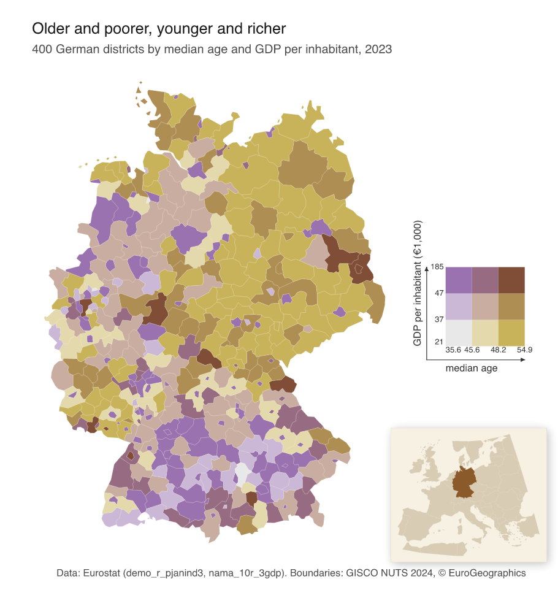{fig-alt="Bivariate choropleth of German districts"}](gallery/bivariate-germany.qmd)

### [Real data, real maps](gallery/bivariate-germany.qmd)

::: {.why-line}
400 German districts by age and income from Eurostat, in one bivariate choropleth.
:::
:::

:::{.why-card}
[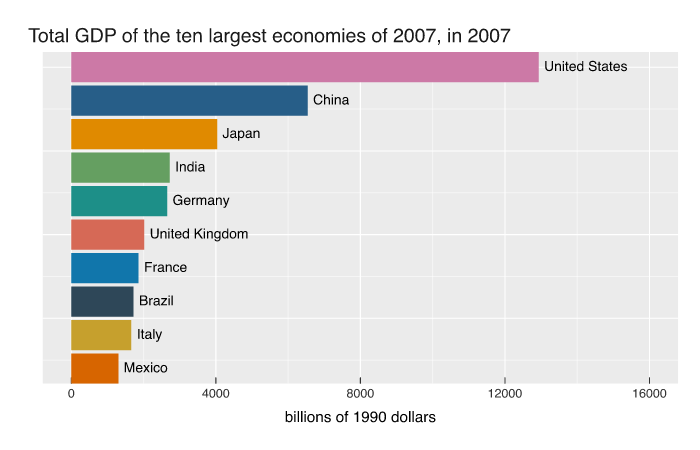{fig-alt="Bar chart race poster frame"}](gallery/bar-race.qmd)

### [Animation with frozen scales](gallery/bar-race.qmd)

::: {.why-line}
Keyframes are compiled once and tweened, so axes and legends hold still while the data moves.
:::
:::

:::::
::::::

## The ecosystem

::::{.eco-grid}

:::{.eco-card}
[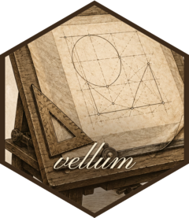{fig-alt="vellum hex logo"}](https://r-vellum.github.io/vellum/)

### vellum

[the parchment]{.role}

A low-level graphics framework in the spirit of grid. Text is measured and layout
solved with no device open, so the scene can say where every element landed before
it is drawn.
:::

:::{.eco-card}
[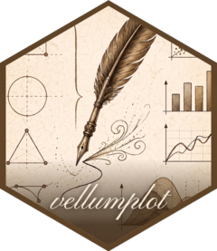{fig-alt="vellumplot hex logo"}](https://r-vellum.github.io/vellumplot/)

### vellumplot

[the pen]{.role}

A declarative, pipe-first grammar of graphics. A plot is an inspectable,
serializable spec until it compiles into a vellum scene.
:::

:::{.eco-card}
[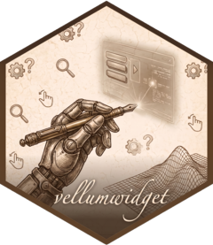{fig-alt="vellumwidget hex logo"}](https://r-vellum.github.io/vellumwidget/)

### vellumwidget

[the annotation]{.role}

Hosts a vellum scene in the browser (hover, select, brush, zoom) by reading the
solved geometry instead of re-drawing the plot in a second engine.
:::

:::{.eco-card}
[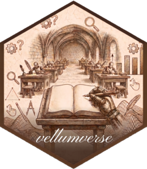{fig-alt="vellumverse hex logo"}](https://r-vellum.github.io/vellumverse/)

### vellumverse

[the meta-package]{.role}

Installs and loads the whole ecosystem together, in the spirit of the tidyverse.
:::

::::

## A taste

A data frame, a few marks, and a trained scale make a whole plot.

```{r}
#| include: false
library(vellumplot)
# Render a plot spec to a PNG and embed it. Using render_plot() (rather than
# knitr's auto-print) keeps rendering off the knitr graphics device, whose
# integer dpi the vellum backend rejects.
vg <- function(p, name, dpi = 150) {
  dir.create("figs", showWarnings = FALSE)
  f <- file.path("figs", paste0(name, ".png"))
  render_plot(p, f, dpi = dpi)
  knitr::include_graphics(f)
}
```

```{r}
p <- vplot(mtcars, width = 7, height = 4.2) |>
  mark_point(x = wt, y = mpg, color = hp, size = 2.4) |>
  mark_smooth(x = wt, y = mpg, method = "lm", se = TRUE) |>
  scale_color_continuous() |>
  labs(
    title = "Weight vs. fuel economy",
    x = "weight (1000 lbs)", y = "miles per gallon", color = "hp"
  ) |>
  theme_minimal()
```

```{r}
#| echo: false
vg(p, "home-taste")
```

See the rest in the [gallery](gallery/index.qmd).
